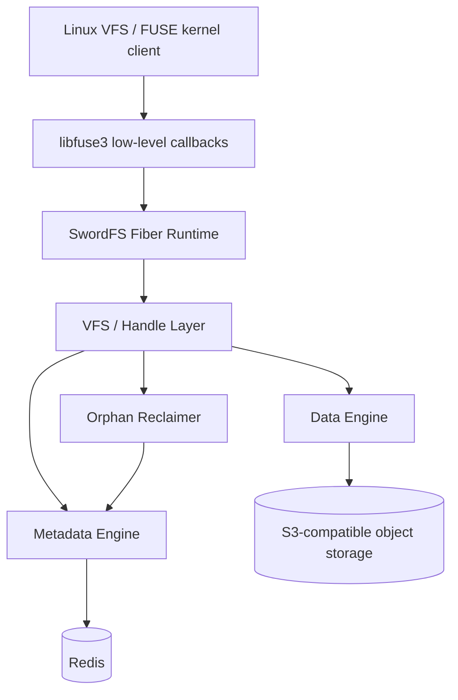
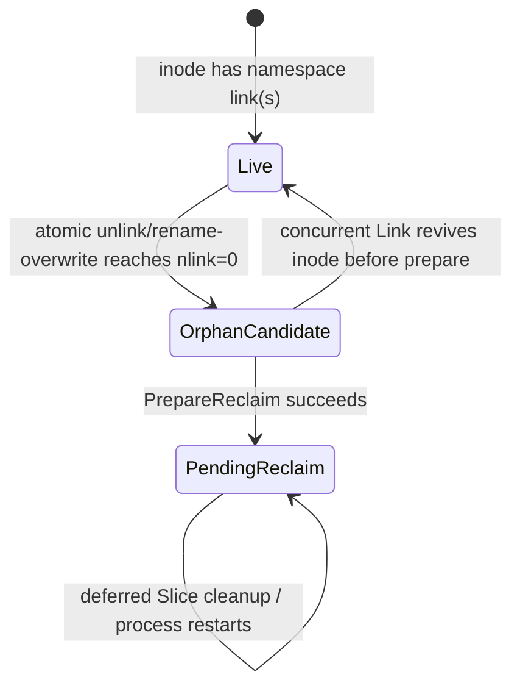

# SwordFS Architecture

This document is the canonical architecture description for the current open-source SwordFS implementation.

It is intentionally more detailed than the project README, but it is not a class-by-class or function-by-function reference. The goal is to explain the major subsystem boundaries, state ownership, request and data flow, correctness invariants, concurrency model, recovery model, and the most important current limitations in one continuous document.

The project README intentionally stays at a conceptual level. Internal interfaces, record layouts, publication protocols, concurrency mechanics, and recovery state machines belong here rather than being duplicated in README.

When implementation changes an architectural contract described here, the same PR should update this document.

Use the [documentation reading path](../README.md) to navigate the design.
Companion documents explain [data structures and ownership](data-structures.md),
the [thread model](thread-model.md), [historical COW publication](chunk-publication.md),
and the [Redis storage model](redis-metadata-schema.md). This overview connects
those mechanisms through the main filesystem workflows.

## 1. Scope and architectural goals

SwordFS is a client-heavy user-space filesystem built on the libfuse3 low-level API. The client is responsible for POSIX-facing semantics, file/chunk state, metadata transactions, object-data placement, retries, and recovery coordination. The current open-source implementation relies on external systems for durable storage rather than implementing a new distributed metadata database or object store.

The architecture is guided by a few recurring principles:

- **Keep filesystem semantics in the client, storage primitives below it.** FUSE/VFS code owns filesystem behavior; metadata and data engines expose storage-oriented contracts.
- **Separate metadata authority from object data.** Namespace/inode/chunk descriptors live in the metadata engine; file bytes live in the data engine.
- **Publish logical chunk heads through metadata.** The selected chunk type implementation prepares data first, then metadata atomically makes its new logical generation authoritative. The implemented `SliceChunk` publishes immutable Slice objects through typed private indexes.
- **Treat persistent metadata as the source of truth for lifecycle/recovery.** Local runtime state may fence or cache work, but must not become the only record of persistent work.
- **Make blocking external IO explicit.** Runtime filesystem logic executes as fibers; Redis/S3 calls run on POSIX worker threads through blocking executors.
- **Prefer clear state ownership over cross-layer reconstruction.** Each lifecycle transition should have one authoritative owner and a small set of explicit invariants.

The current implementation should be understood as an evolving architecture baseline. Some interfaces intentionally allow additional backends later, but this document distinguishes extension points from backends that exist today.

## 2. System overview

At a high level, SwordFS is split into five cooperating layers:



The major responsibilities are:

| Layer | Primary responsibility | Does not own |
| --- | --- | --- |
| FUSE hooks | Translate libfuse requests/replies and admit work into the fiber runtime | Filesystem state or persistence |
| VFS/handle layer | POSIX-facing orchestration, open-handle lifetime, file/chunk runtime state | Durable namespace storage implementation |
| Metadata engine | Authoritative inode, directory, typed chunk mapping, transaction, orphan/reclaim metadata | File object bytes |
| Data engine | Put/Get/Delete immutable file objects | Namespace/link/inode semantics |
| Orphan reclaimer | Apply the mount-local open-handle fence and hand durable orphan candidates to metadata preparation | Physical object deletion or mechanism-specific cleanup payloads |

`VolumeImpl` is the mount composition root. It binds one mounted volume to one
metadata engine and, when configured, one data engine. After loading the
persisted `ChunkType`, it opens the chunk-type-selected typed `ChunkMetadata`
capability, binds the pure `ChunkCleanupWorkEncoder` for detached ChunkID
maintenance, and then constructs the mount-owned `ChunkFactory`. No physical
Slice GC worker is instantiated. VFS sees
only the stable `ChunkFactory`/`Chunk` data-path facade and never receives the
typed mechanism metadata capability or a chunk-type implementation object.
Backends are selected by URL scheme through registries rather than hard-coded
into VFS code.

## 3. Process and mount lifecycle

SwordFS has two top-level commands relevant to architecture: `format` and `mount`.

### 3.1 Format

`swordfs format` creates the persistent volume configuration through the selected metadata backend.

The volume configuration contains, among other fields:

- volume name;
- data-engine identity;
- bucket/location string interpreted by that data engine;
- region;
- configured logical chunk size;
- typed chunk type.
- persistent POSIX ACL feature enablement.

Volume configuration is persisted in Redis alongside the namespace, inode,
chunk, orphan, and pending-reclaim state. There is no local volume config file.

The persisted data-engine identity is authoritative for backend selection.
The bucket/location string is backend-specific configuration rather than a
second source of engine identity. A persisted volume either has both fields
populated or neither; volume decoding rejects a one-sided record. Mount then
selects the data engine solely from the validated persisted identity instead of
inferring it from the location or silently omitting the data plane. Persistent
metadata uses schema version 1; decoders require an exact match as part of
current-format validation. Beta metadata layouts may change in place without
introducing schema-version transitions or compatibility decoders.

### 3.2 Mount

The mount sequence is intentionally ordered so thread-owning components are created only after daemonization/forking:

1. validate/create the mount point;
2. daemonize when not running in foreground mode;
3. initialize `VolumeImpl`;
4. create and initialize the metadata engine;
5. load the persisted volume configuration;
6. create the data engine from the volume's persisted engine identity, then
   initialize it from the persisted backend-specific location/configuration;
7. create the libfuse low-level session and enter the multi-threaded FUSE loop;
8. initialize the first fiber runtime and the background reclaim worker from the FUSE init hook; other threads that submit filesystem work create their thread-local `FiberRuntime` lazily through `RunInFiber`.

FUSE mount options that affect SwordFS userspace semantics are normalized once
at the mount boundary into the process-global `MountRuntimeBehavior` singleton.
The original option string is still passed to libfuse unchanged. This runtime
behavior is not persistent volume metadata. `RunMount` initializes the
singleton before request processing begins, and runtime components read the
normalized policy directly. `VolumeImpl`, metadata factories, and operation
interfaces do not carry mount-policy arguments. The metadata runtime therefore
consumes typed runtime policy without parsing raw FUSE options or reaching back
into `ConfigCenter`.

Persistent volume features follow a different authority path. POSIX ACL
enablement remains owned by the loaded `SwordFsVolume`; the FUSE init hook
combines that persisted feature with the kernel ACL capability pair and stores
only the resulting effective state in `MountRuntimeBehavior`. It is therefore
not reconstructed from a mount CLI flag or copied through metadata operation
arguments.

`noatime` currently controls only SwordFS's existing implicit access-time side
effects on file `Open` and directory `OpenDir`. The normal `VfsImpl`, handle,
and `IMetaEngine::Open`/`OpenDir` operation contracts do not carry mount-policy
arguments because the policy is fixed for the lifetime of the mounted daemon.
Explicit timestamp changes requested through `SETATTR` remain independent of
this implicit-access policy.

At unmount, the reclaimer stops before the fiber runtime and storage engines are destroyed. This ordering prevents a background worker from borrowing an engine or fiber runtime after its lifetime has ended.

## 4. FUSE and VFS request path

SwordFS uses the **libfuse3 low-level API**, so callbacks operate on inode IDs rather than requiring high-level path reconstruction inside libfuse.

The FUSE hook layer is deliberately thin:

```text
kernel request
   -> libfuse low-level callback
   -> RunInFiber(...)
   -> set request context (uid/gid/pid)
   -> VfsImpl operation
   -> Status -> fuse_reply_*
```

`VfsImpl` is the main filesystem-orchestration boundary. It translates FUSE/POSIX operations into:

- direct metadata operations for namespace/attribute operations;
- `FileHandle`/`InodeHandle` operations for open file IO;
- `DirHandle`/metadata iterators for directory enumeration;
- wakeups to `OrphanReclaimer` after namespace changes that may create logical orphan work; physical chunk GC is not exposed to VFS.

Before dispatching an operation, the FUSE hook captures the request caller's `uid`, `gid`, `pid`, and `umask` into fiber-local `SwordFsContext`. With `default_permissions`, Linux VFS owns ordinary POSIX DAC, including pathname checks, supplementary groups, and capability overrides. Metadata uses the captured context for post-authorization semantics that still require caller identity, including ownership assignment and transaction-local sticky-directory ownership safety; it does not reconstruct a second mode-bit permission engine.

The current FUSE configuration is conservative around cache/coherency semantics:

- writeback cache is explicitly disabled;
- splice-write is explicitly disabled;
- splice-read is enabled when supported by the kernel/libfuse capability set;
- async read, readdirplus, and atomic truncate are enabled when available.

This matters because SwordFS currently owns dirty chunk state in userspace. Kernel writeback caching would otherwise hide important daemon-side write/flush/publication semantics.

## 5. Volume and backend abstraction

`VolumeImpl` is the process-level owner of the mounted volume's storage engines.

```text
VolumeImpl
  |- SwordFsVolume config
  |- IMetaEngine
  `- IDataEngine
```

Backend creation is registry-driven:

- `MetaEngineRegistry` creates a metadata engine from the metadata URL scheme;
- `DataEngineRegistry` creates a data engine from the persisted volume engine identity.

`ConfigCenter` owns CLI/process configuration. The command path passes that
configuration to `VolumeImpl` through a narrow adapter overload, which
immediately normalizes it into explicit `FormatOptions` / `MountOptions` value
objects; `VolumeImpl` does not reach back into the global configuration
singleton. `VolumeImpl::Initialize` creates an empty process runtime.
`LoadFrom()` then binds the persisted volume and constructs metadata/data
engines through the registered production factories.
Tests that need alternate engine implementations use those same option,
registry, and load paths; the production singleton API does not expose engine
mutation or test-only injection seams.

Data-engine initialization is also explicit. `VolumeImpl::LoadFrom()` combines
the persisted backend location/region with runtime-only mount settings such as
the storage worker count into `DataEngineOptions`, then passes that value
through `DataEngineRegistry` to the selected engine. A data engine must not
reach back into `VolumeImpl::Instance()` or `ConfigCenter::Instance()` to
recover its own configuration. This keeps engine ownership local to the
mounting `VolumeImpl`, avoids hidden process-global state coupling, and makes
the same production construction path usable by focused tests.

### 5.1 Implemented metadata backends

The current repository implements **Redis** (`redis://...`) as its only
production metadata backend, using persistent metadata and optimistic
transactions. Test-only metadata engines exercise narrow upper-layer contracts
without implementing a second durable namespace.

The abstraction is intentionally backend-neutral, but other metadata engines should not be described as implemented until they actually exist in the repository.

### 5.2 Implemented data backend

The current repository implements an **S3-compatible data engine** selected through an `s3://...` bucket URL.

The S3 engine supports:

- object `Put`;
- ranged `Get`;
- idempotent `Delete` (deleting an already-absent immutable key is successful);
- optional bucket prefixing;
- MinIO/path-style access and virtual-hosted access configuration.

New data engines can be added through the registry without changing the VFS contract.

### 5.3 Backend liveness, retry ownership, and outcome certainty

External-I/O failures have two different meanings that must not be collapsed.
A transport or admission failure explains **why progress stopped or certainty
was lost**; it does not by itself prove whether a remote mutation executed.
SwordFS therefore separates the low-level failure cause from the terminal
semantic result that crosses a backend boundary.

`utils::Status` carries the terminal distinction needed by upstream correctness
logic:

- `Unavailable` means the backend operation cannot currently complete and the
  owning automatic-retry policy has stopped, with no unresolved remote mutation
  outcome at that abstraction boundary;
- `OutcomeUnknown` means a side effect may have changed authoritative remote
  state and SwordFS cannot prove whether it executed.

Both are internal statuses and currently map to `EIO` at the FUSE boundary.
The errno is intentionally not an oracle for remote execution state. Timeout,
connection reset, pool admission failure, backend exception type, retry count,
and elapsed time remain backend-local diagnostic/observability information
unless a future cross-layer consumer requires them. Read-only operations must
never manufacture `OutcomeUnknown` because they have no remote mutation whose
execution can be ambiguous.

Exactly one layer owns automatic transport/protocol retry for each backend
attempt path: the nearest layer that knows both the failure boundary and
whether replaying the same operation identity is safe. VFS and callers must not
add generic retry loops around `EIO`, `Unavailable`, or `OutcomeUnknown`.
Operation classes follow these rules:

| Operation class | Automatic retry rule | Terminal result when certainty cannot be obtained |
| --- | --- | --- |
| Read-only | May retry within the backend owner's bounded policy | `Unavailable` |
| Idempotent mutation with stable identity | May replay the same identity within the bounded owner policy | `OutcomeUnknown` if an attempt may have applied but acknowledgement remains unknown; otherwise a known failure |
| Conditional/reconcilable mutation | Retry only at protocol-defined safe boundaries; after ambiguity, reconcile authoritative state | `OutcomeUnknown` until reconciliation resolves it |
| Non-idempotent, non-reconcilable mutation | Never blindly replay after execution may have occurred | `OutcomeUnknown` |

Reconciliation is not a second transport retry loop. It is an operation-level
protocol action that reads or compares authoritative state to determine what
already happened.

Backend liveness policy is likewise owned at the external-I/O boundary rather
than by a mount-wide FUSE deadline. A backend is responsible for bounding waits
that can otherwise prevent progress, including connection establishment, pool
or worker admission when applicable, transport no-progress handling, and retry
attempts/backoff. Large operations that are still making legitimate progress
do not need to fail merely because a short absolute wall-clock interval elapsed.
Blocking executor callbacks are not detached on timeout: returning while such a
callback still owns caller buffers or stack state would violate lifetime safety,
and local cancellation would not prove that a remote mutation stopped.

## 6. Metadata architecture

`IMetaEngine` is the filesystem's authoritative metadata contract. It covers:

- inode and attribute operations;
- directory entries and namespace mutations;
- hard/symbolic links;
- directory iteration;
- chunk descriptor allocation/publication/lookup;
- truncate;
- orphan and pending-reclaim lifecycle;
- volume format/load/statistics.

### 6.1 Metadata operation contract

Runtime metadata operations execute in the **fiber domain** and are required to be atomic with respect to concurrent observers.

For example, a rename that replaces an existing target cannot expose an intermediate state where the target is gone but the source has not yet moved. Backends may implement atomicity differently, but `IMetaEngine` defines one semantic result.

Lifecycle/control operations such as engine construction, initialization, format, load, and destruction execute in the **POSIX-thread domain**.

### 6.2 Core metadata model

The common logical records are `SwordFsInode`, directory entries, and the
FileMetadata-owned mapping `ChunkIndex -> ChunkID`. `ChunkIndex` is a checked
unsigned 64-bit logical coordinate; `ChunkID` is a monotonic volume-scoped
identity that is never reused after detach. The ordered Slice records and their immutable object identities belong
to private typed ChunkMetadata, outside FileMetadata. A missing mapping inside EOF represents a sparse hole.

For relationships between these records, handles, and write buffers, see
[Data structures and ownership](data-structures.md).

### 6.3 Metadata transaction authority

The Redis implementation owns durable FileMetadata state and makes composite
namespace/chunk transitions visible atomically through its transaction layer.
`AttachPrepared`, `FinalizeAttachedWrite`, `CommitShrink` and `CommitGrow`
atomically validate and mutate FileMetadata mappings and inode EOF. Private Slice record publication remains a separate domain and is never
part of the same FileMetadata Redis transaction. The pure `ChunkCleanupWorkEncoder` only serializes detached
ChunkID identities for safe maintenance; it does not consult or mutate private
Slice metadata.

No pointers to mutable transaction-owned inode state escape as authoritative
state; callers observe value snapshots and commit mutations transactionally.

### 6.4 Redis layering

The Redis metadata implementation is split so filesystem policy, metadata semantics, and Redis mechanics remain distinct:

```text
RedisMetaImpl   - IMetaEngine policy/validation layer
    |
RedisMetaOps    - standalone operation orchestration / retry boundary
    |
RedisMetaTxn    - transaction-scoped filesystem metadata semantics
    |
RedisKvTxn      - WATCH / MULTI / EXEC mechanics
    |
RedisMetaClient - raw Redis access
```

Redis runtime calls are synchronous from the Redis client library's perspective, so they are executed on a `BlockingExecutor` POSIX thread pool while the calling fiber suspends on a baton.

All Redis keys belonging to one SwordFS volume currently share one Redis Cluster hash tag. This is an intentional transaction-locality trade-off: multi-key filesystem mutations can stay in one Redis transaction/slot, but a single volume is therefore not horizontally sharded across multiple Redis Cluster slots by the current schema.

### 6.5 Redis optimistic concurrency

`RedisKvTxn` enforces a read-before-write transaction discipline:

- transaction reads `WATCH` the relevant key;
- reads after the first queued write are rejected by the wrapper;
- writes are queued into `MULTI/EXEC`;
- a WATCH conflict is surfaced as a conflict so the operation can be retried at the operation layer.

Redis `MULTI/EXEC` is not a rollback transaction: an individual queued command may fail after earlier commands have succeeded. The transaction wrapper therefore validates EXEC replies and returns `OutcomeUnknown` for such possible partial commits.

Timeout or connection loss after EXEC is also returned as `OutcomeUnknown`, not as proof that nothing happened. Retryable paths already owned by `RedisMetaClient`—WATCH conflicts and timeout/close failures that escape before a write transaction reaches EXEC—remain private retry control flow; exhausting that bounded policy returns `Unavailable`. This issue does not broaden the existing retry set. Metadata operations that can face ambiguous outcomes must therefore be idempotent or able to reconcile the resulting durable state rather than blindly replaying a failed errno.

Detailed Redis key layout and access patterns are documented separately in [Redis Metadata Schema and Access-Pattern Review](redis-metadata-schema.md). That document is a persistence-detail reference; this document remains the architecture entry point.

## 7. FUSE inode and file-handle runtime ownership

Kernel-visible inode lifetime, open-file runtime state, and persistent metadata
have separate ownership.

The low-level FUSE protocol may keep referring to an inode after its final
namespace name has been removed. SwordFS therefore keeps a mount-local inode
representation for every inode with outstanding FUSE lookup references:

```text
FUSE entry reply / READDIRPLUS
  -> LocalInode (per inode within the mount)
       - lookup reference count
       - LIVE or DETACHED state
       - cached SwordFsInode

FORGET / FORGET_MULTI
  -> drop lookup references
  -> destroy a detached LocalInode when its final reference is gone
```

For a `LIVE` inode, the metadata engine remains authoritative; the local copy
is not a general write-back metadata cache. `GETATTR` reads authoritative
metadata first. If and only if that lookup returns `NotFound` while the
mount-local object still has lookup references, the object transitions lazily
to `DETACHED`, its cached `nlink` is normalized to zero, and validated
inode-only requests can continue from that local representation. Transport or
other metadata failures never fall back to cached state. The durable metadata
engine therefore does not need rename-victim plumbing or to keep a directory
inode solely because the current FUSE mount still has a lookup reference.

This state is intentionally ephemeral. On unmount or process failure the FUSE
connection and its lookup references disappear with the local registry; the
metadata engine already contains the durable post-namespace-mutation state.

Open-file runtime state is separately owned.

The main ownership chain is:

```text
FUSE file handle
  -> FileHandle
  -> shared InodeHandle (per inode within the mount)
  -> FileReadWriter
  -> FileChunkManager
  -> Chunk objects
```

`HandleManager` maps FUSE handle IDs to open `FileHandle`/`DirHandle` objects.

`InodeHandleManager` maintains shared per-inode handles through weak references so multiple opens in the same mount can share runtime state without keeping every inode alive forever.

The FUSE lookup registry and `InodeHandleManager` deliberately solve different
problems. Lookup references retain an inode identity/attribute representation
for kernel requests. `InodeHandle` retains regular-file data-path state and
the open/reclaim fence required for final-close flush and durable object
cleanup. FUSE lookup references do not, by themselves, delay Redis/object
reclaim.

`InodeHandle` owns two important runtime concepts:

- the count of live/opening descriptors;
- a local **reclaim fence**.

The reclaim fence prevents a background reclaim from crossing the metadata point of no return while a descriptor is open or still being opened. It is runtime safety state only; whether reclaim work exists is determined by durable metadata, not by an in-memory orphan flag.

The final close keeps its descriptor reference counted until its flush completes. This prevents reclaim from freezing/removing the inode while dirty data is still being flushed.

Directory handles follow the same separation of runtime and backend state. `DirHandle` owns a backend-neutral `DirIterator`; Redis keeps its private `HSCAN` cursor/prefetch state behind the iterator. The FUSE directory offset is a logical cookie and is not exposed as a Redis cursor.

READDIR and READDIRPLUS deliberately diverge only after entry enumeration. Plain
READDIR encodes `SwordFsEntry` records directly and never fetches inode metadata.
READDIRPLUS gathers a bounded batch of entries, asks `IMetaEngine::GetInodes()`
for the corresponding persistent inode records, composes any tracked/open local
inode overlay, and only then encodes `fuse_entry_param`. Redis uses one ordered `MGET` for the batch, so
PLUS does not create a per-entry metadata round trip.

The directory scan and attribute read are not one transaction-wide snapshot.
An entry whose inode disappears between enumeration and the batch attr read is
skipped; transport errors, malformed inode records, and inode-identity mismatch
remain hard errors. This makes concurrent unlink/rename behavior explicit
without returning fabricated attributes. If a concurrent rename moves an
already-enumerated name while its inode remains live, that observed pre-rename
name may still be returned with attributes bound to the same inode; directory
enumeration intentionally does not promise snapshot isolation.

Tracked/open state is composed onto the already-fetched persistent inode rather
than by calling `GetAttr()` again. The attr guard retains the `FileReadWriter`
whose shared operation lock it owns, so the lock and overlay source have one
RAII lifetime. In particular, a dirty file's live size is applied without a
second backend lookup, preserving the local coherence invariant while retaining
bounded Redis RTTs.

For tracked inodes, the persistent batch read and local overlay are one local
consistency window. `DirHandle` resolves the tracked handles in a batch,
deduplicates hard-linked inode IDs, orders them by inode ID, and holds each
file's shared operation lock across `GetInodes()` and overlay composition. A
concurrent local write, flush, truncate, or size-changing setattr therefore
cannot slip between the persistent snapshot and its live overlay. The batch is
bounded at 128 entries, so this can briefly delay writes to at most that many
tracked files for one backend batch-read RTT; the bound and single-RTT read are
the deliberate trade-off for avoiding both inconsistent mixed snapshots and an
N+1 metadata path.

READDIRPLUS currently uses zero entry and attribute cache timeouts. SwordFS has
no cross-mount dentry/inode invalidation or lease mechanism that would justify
caching directory-enumeration results; the previous one-second values were a
provisional implementation detail rather than a coherence guarantee.

## 8. Chunk and data model

Files are divided into fixed-size logical chunks (default 64 MiB). Each
persistent volume records one numeric `ChunkType`: COW=1 is a **retired**
identity, Slice=2 is the only implemented mechanism, and RedisCache=3 is
reserved. The numeric values must never be reinterpreted. New COW formats and
mounts of stored COW records fail closed; they are not silently converted.

The common FileMetadata domain owns inode EOF and the mapping
`ChunkIndex -> ChunkID`. ChunkIndex is 64-bit, checked against Linux
non-negative `off_t` limits; ChunkID is a stable volume-scoped identity.
Mechanism-private state belongs to the typed `ChunkMetadata` capability:
Slice maintains ordered `SliceRecord` entries per ChunkID, with separate
immutable Slice object IDs. The mapping never contains private record lists.

`src/chunk/Chunk.hpp` is the mechanism-neutral VFS boundary. The concrete
`ChunkFactory` dispatches only to `src/chunk/slice/SliceChunk.*` today.
`FileReadWriter` owns cross-chunk splitting, EOF visibility and local
flush/truncate coordination. The factory and typed metadata capability retain
extension points for future independently implemented mechanisms.

Blocking data-engine operations have a finite request deadline and retry
budget; a network timeout does not prove a remote mutation was not applied.

## 9. Write and publication path

A successful buffered write only updates the local dirty view. The Slice
implementation freezes dirty ranges, including optional 1 MiB window-RMW
coalescing, into immutable objects. Coalescing is a cache optimization, not
another persistent Chunk type. A `SliceRecord` associates a logical range
with an immutable Slice object and its object offset.

### 9.1 First attachment

A new logical chunk allocates a fresh ChunkID and creates its nonempty private
Slice record index before the FileMetadata `AttachPrepared` transaction
conditionally attaches that ChunkID and publishes the authoritative EOF.
Objects are written before the referencing private record becomes visible.
A failed attachment may leave an orphan object/index, never an attachment to
unwritten data.

### 9.2 Rewrite and flush

An attached ChunkID appends new immutable Slice records; overlapping records
resolve in publication order. The FileMetadata finalization validates the
attached identity and EOF preconditions. Later readback overlays the latest
committed record data onto earlier ranges, with local dirty bytes taking
precedence while pending.

### 9.3 Failure boundary

A successful object Put is not proof of publication. Ambiguous Redis responses
must reconcile authoritative private index and FileMetadata state before
retry. The writer must not blindly append a duplicate record or publish an
old dirty generation over a newer one. Physical Slice cleanup is **not
enabled**: opaque detach/reclaim work is retained until #273 proves safe
reachability and reader-lifetime constraints.

## 10. Read path

`FileReadWriter` maps a requested byte range onto bounded logical chunk
indexes. Every offset and length is checked before lookup; invalid requests
cannot partially mutate cached state. A missing mapping within EOF represents
a sparse hole. `SliceChunk::Read` resolves persisted Slice records, overlays
pending local dirty ranges in acceptance order, and zero-fills uncovered
regions; a read spanning multiple chunks can submit independent read fibers.

S3 ranged reads fill caller-provided buffers directly rather than requiring
an additional string copy.

## 11. Flush, fsync, close, and visibility

`Flush` publishes dirty immutable Slice objects and their metadata, subject
to the configured per-file chunk concurrency bound. A successful buffered
`write(2)` is **not** a persistence acknowledgement; flush/fsync-style
operations wait for recognized publication success. The final close flushes
before releasing the final local open reference. `O_SYNC` / `O_DSYNC`
write-through is not yet implemented. Persistence after backend acknowledgements
is bounded by Redis and object-store durability policies, not a separate
SwordFS disk barrier. Unreachable objects may leak while safe physical
cleanup is disabled.

### 11.1 Open/close ordering against reclaim

An open must acquire its local reference before authoritative metadata
validation. The reclaim fence and open counter cannot race: if a final
unlink occurs while a descriptor remains open, it becomes an orphan rather
than deleting its reachable inode. Final close releases the reference after
flush and wakes the orphan worker. The fence is mount-local, not a
distributed open lease.

## 12. Truncate behavior

The per-inode operation lock serializes truncate against writes and flushes.
FileMetadata commits EOF and detached chunk mappings under checked,
optimistic transaction preconditions; `SliceChunk` sanitizes retained
boundary state so a later grow does not reveal discarded bytes. Local cached
chunks beyond the new EOF are invalidated. Detached identities generate
opaque Slice cleanup work, **not physical object deletions**. Pending work
can remain indefinitely until a future safe Slice GC implementation.

Sparse truncate planning scans materialized mappings, not every possible
logical chunk index. Partial/ambiguous Redis outcomes must be reconciled from
authoritative state before acknowledging a size change.

## 13. Runtime and concurrency model

SwordFS intentionally defines exactly two execution domains:

1. **Fiber domain** — filesystem runtime/business logic actively executing as a Folly fiber;
2. **POSIX-thread domain** — normal threads used for lifecycle/control code and blocking external IO.

There is no generic or unknown third execution domain.

See [Thread model and synchronization](thread-model.md) for execution topology,
worker handoff, state protection, and the shutdown state machine.

### 13.1 Fiber runtime

FUSE callbacks submit work through `RunInFiber`. A `FiberRuntime` owns:

- a Folly `EventBase`;
- a driver thread;
- a FiberManager;
- admission/drain state used during shutdown.

Callbacks return after admitting work; the driver advances fibers asynchronously.

Shutdown first stops new task admission, waits for admitted fibers to drain, then terminates and joins the runtime driver.

### 13.2 Synchronization contract

SwordFS wraps synchronization primitives with semantic types:

- `FiberMutex` / `FiberRWMutex` — state owned by fiber-reachable business logic;
- `ThreadMutex` — state owned only by POSIX-thread control/blocking code;
- `FiberBaton` — cross-domain handoff/wakeup primitive.

In Debug builds these wrappers verify the current execution domain. The build also runs a `check_fiber_safety` target to reject raw synchronization primitives in production code where project rules require the semantic wrappers.

### 13.3 Blocking external IO

Redis and S3 client libraries perform blocking calls. SwordFS does not execute those calls directly on a fiber driver thread.

`BlockingExecutor::RunFromFiber`:

1. verifies the caller is in the fiber domain;
2. submits the blocking operation to a POSIX worker pool;
3. suspends the fiber on a baton;
4. resumes it after the worker posts completion.

This keeps the programming model synchronous at the filesystem call site while avoiding blocking the fiber scheduler's driver thread.

## 14. Namespace unlink and durable reclaim

Deleting a directory entry and deleting the underlying object data are intentionally separate phases.

When `unlink` or rename-overwrite drops a regular file's link count to zero, the metadata mutation atomically publishes an **orphan candidate**. The foreground VFS operation then wakes `OrphanReclaimer` and returns; it does not synchronously delete file objects.

This design ensures that a crash after the namespace mutation does not lose knowledge that cleanup is required.

### 14.1 Reclaim state machine



The **metadata point of no return** is `PrepareReclaim`.

In one atomic metadata transition it must:

1. re-check that the inode is still unlinked;
2. let the private metadata bridge freeze durable cleanup work from the
   authoritative logical heads and mechanism-private metadata;
3. remove the live inode/chunk metadata and orphan marker in the same metadata
   transaction, so a later hard link cannot revive an inode whose data is
   being deleted.

After this point, `ReclaimWork` remains a durable, opaque deferred cleanup
record; there is no active physical Slice GC worker. The future #273 cleanup
implementation must revalidate authority and fail closed if a Redis `EXEC`
published pending work without completing live-inode removal.
`IMetaEngine::PrepareReclaim` never returns physical identities to VFS.

### 14.2 Open-file fence

Before preparing an orphan, `OrphanReclaimer` acquires the inode's local reclaim fence from `InodeHandle`.

The fence can be acquired only when:

- no descriptor/open attempt holds an inode reference;
- no other local reclaim attempt owns the fence.

If a file has been unlinked while still open, the durable orphan remains in metadata and the orphan worker simply retries later. The final close wakes `OrphanReclaimer` after its flush/reference release.

Once metadata preparation removes the live inode, the local fence can be released even while object deletion continues: new opens can no longer find the inode through authoritative metadata.

### 14.3 Orphan handoff and deferred Slice maintenance

`vfs::OrphanReclaimer` scans durable orphan candidates, acquires the local
reclaim fence, calls `PrepareReclaim`, and releases the fence after a safe
metadata outcome. It never deletes Slice objects or decodes private object
identities. Redis retains opaque `ReclaimWork` and `PendingDelete` records;
the Slice encoder serializes detached ChunkID references but authorizes no
physical deletion.

The retired COW-only `ChunkGcWorker` and participant scaffolding were removed
because they no longer had any production caller. #273 must design and test
private-index reachability and reader-lifetime checks before introducing a
new physical Slice cleanup worker.

## 15. Crash, retry, and ambiguous-result principles

Several architecture rules exist specifically because external systems can fail after partially completing an operation.

### 15.1 Chunk publication

An object upload may succeed while its private record append or FileMetadata
attachment is unconfirmed. A failed commit can leave unreachable data; an
ambiguous commit must be reconciled by reading the authoritative Slice index
and FileMetadata. Retrying blindly risks duplicate records or stale logical
attachment. No failed outcome may authorize physical deletion of a potentially
live Slice object.

### 15.2 Redis transaction ambiguity

After Redis EXEC, a timeout or connection close does not prove whether the server committed the transaction. Callers must treat the result as ambiguous and rely on idempotent/reconciliation-aware metadata operations rather than assuming rollback.

### 15.3 Reclaim

`PrepareReclaim` makes the inode non-revivable in persistent FileMetadata and
freezes detached ChunkID identities into an opaque maintenance envelope.
Ambiguous Redis outcomes require fresh reads. Slice physical GC is deliberately
disabled, so unreferenced objects may leak but remain unavailable through the
authoritative file mapping. The design prefers leaking unreachable objects over
risking deletion of live data.

## 16. Performance-sensitive design choices

The current implementation contains several deliberate choices intended to keep the client data path efficient:

- low-level FUSE avoids high-level path resolution in libfuse;
- multi-chunk reads can execute chunk reads concurrently in fibers;
- Folly `IOBuf` is used to reduce avoidable data copies;
- S3 Put wraps the existing buffer instead of first materializing a temporary string;
- S3 Get can stream directly into caller-provided writable buffer space;
- Redis and S3 blocking calls use dedicated POSIX worker pools;
- metadata/data backend interfaces keep VFS independent from backend-specific connection/client objects;
- immutable revisioned object identities allow lock-free object naming at the data-store level and move authority changes into metadata transactions.

There are also known performance costs in the current design:

- rewriting a published object-storage chunk hydrates and rewrites the whole chunk;
- there is no slice/extent delta representation or background compaction path;
- S3 multipart upload is not currently supported by the data engine;
- metadata and data path are client-heavy, so client CPU/thread/fiber behavior directly affects filesystem performance.

These costs should be treated as design constraints for future work, not hidden implementation details.

## 17. Current capability boundaries

The architecture described above covers the implemented open-source path. Several FUSE operations are currently explicit `NotSupported` paths, including:

- `flock`;
- `fallocate`;
- `tmpfile`;
- `statx`;
- `ioctl` and retrieve-reply handling;
- `fsyncdir`;
- `lseek` specialization.

These should not be inferred from the broad project mission as already implemented semantics.

Special-node namespace creation is implemented through the low-level FUSE
`mknod` path for regular files, FIFOs, character devices, block devices, and
socket nodes. The authoritative type/mode/device identity is persisted by the
metadata engine and returned in the successful FUSE entry reply; ordinary
authorization remains owned by the kernel/FUSE boundary.

The current open-source backend set is also intentionally narrower than possible future architecture:

- metadata: Redis;
- data: S3-compatible object storage.

Additional metadata/data engines are extension opportunities through the registries, not current capabilities unless present in the repository.

Raw `user.*` extended attributes and Linux
`system.posix_acl_{access,default}` bytes are persisted in
`SwordFsInode` and exposed through the low-level FUSE xattr callbacks. POSIX
ACL names are exposed only when the kernel advertises both POSIX-ACL and
DONT_MASK capabilities; Linux VFS remains the authorization authority while
SwordFS validates, inherits, and synchronizes ACL state with inode mode. Other
`system.*` and `trusted.*` namespaces remain unsupported. See
[Persistent extended attributes](378-persistent-xattrs.md) and
[POSIX ACLs](396-posix-acl.md).

## 18. Architectural invariants for future changes

Future changes should preserve or explicitly revise the following contracts:

1. **Authoritative metadata operations are atomic.** Namespace observers must not see intermediate composite-operation state.
2. **Runtime filesystem metadata operations execute in the fiber domain; blocking backend IO executes in POSIX worker threads.**
3. **Unpublished chunk data is not authoritative shared metadata.** Immutable Slice data is written before its referencing private records and FileMetadata attachment are published.
4. **Published object identities are immutable.** ChunkID and SliceID are nonzero volume-scoped identities not reused after detach.
5. **Rewrite publication is conditional and ordered.** A stale writer must not erase a newer committed logical record or EOF.

6. **Open-handle runtime state does not replace durable metadata.** Local fences protect transitions; they are not persistent lifecycle records.
7. **Last-link deletion is recoverable.** The metadata mutation that removes the last name must durably publish cleanup work before the foreground request can forget the inode.
8. **Deletion after reclaim uses mechanism-frozen targets.** The common
   metadata and VFS orphan layer do not reconstruct physical references from
   the logical chunk head after the point of no return.
9. **Slice physical deletion is disabled.** Cleanup work is deferred; no pending-delete entry authorizes removal without a future mechanism-specific reachability proof.
10. **A future data-engine delete must be idempotent.** Queued cleanup may be retried after restart or an ambiguous response.
11. **Ambiguous external commits are not assumed to have rolled back.** Retry/reconciliation semantics must be safe under either outcome.
12. **Shutdown ordering respects borrowed lifetimes.** Background work stops before the fiber runtime and engines it uses are destroyed.

Any PR that changes one of these invariants should update this document as part of the same change.

## 19. Known evolution areas

The following areas are intentionally not presented as solved architecture:

- Slice record growth and compaction remain future work (#274);
- safe Slice physical reclamation is blocked on private-index and reader-lifetime proofs (#273);
- `redis_cache` has no implemented Chunk mechanism;
- multi-mount/session ownership semantics are not represented by a distributed lease/session layer in the current architecture;
- reclaim pending-work representation and progress tracking can be made more storage-native/compact over time;
- GC backlog/age/throughput observability is still limited;
- additional data and metadata backends may require revisiting capability contracts rather than simply registering a new factory.

These areas should be documented here when their architecture becomes concrete, rather than described as existing capability in advance.

## 20. Code map and deeper references

The most useful source entry points are:

| Area | Main source |
| --- | --- |
| mount/volume lifetime | `src/cmd/Mount.cpp`, `src/volume/VolumeImpl.*` |
| FUSE admission/replies | `src/fuse/Vfs.*` |
| VFS semantics | `src/vfs/VfsImpl.*` |
| open handles/runtime state | `src/vfs/FileHandle.*`, `src/vfs/InodeHandle.*`, `src/vfs/DirHandle.*` |
| file/chunk IO | `src/vfs/FileReadWriter.*`, `src/chunk/Chunk.*`, `src/chunk/ChunkFactory.*`, `src/chunk/slice/SliceChunk.*`, `src/chunk/slice/SliceRecord.*` |
| FileMetadata authority and typed size transitions | `src/metadata/IMetaEngine.hpp`, `src/metadata/ChunkSizePlan.hpp` |
| mechanism-private ChunkMetadata and cleanup encoding | `src/metadata/ChunkMetadata.hpp`, `src/chunk/internal/ChunkCleanupWorkEncoder.hpp` |
| Redis metadata | `src/metadata/redis/` |
| data-engine abstraction | `src/storage/IDataEngine.hpp` |
| S3 data engine | `src/storage/s3/` |
| runtime/concurrency | `src/utils/FiberRuntime.*`, `src/utils/BlockingExecutor.*`, `src/utils/Synchronization.hpp` |
| orphan reclaim handoff | `src/vfs/OrphanReclaimer.*`, `src/vfs/InodeHandle.*` |
| deferred cleanup records (no Slice physical GC) | `src/chunk/slice/SliceDeferredCleanup.*`, `src/metadata/types/Reclaim.*` |

For Redis persistence details, see [Redis metadata: storage and transactions](redis-metadata-schema.md).
