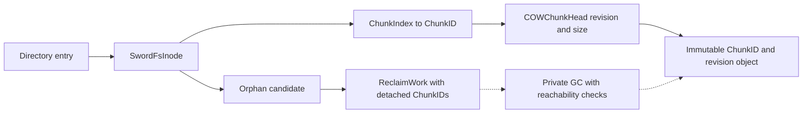
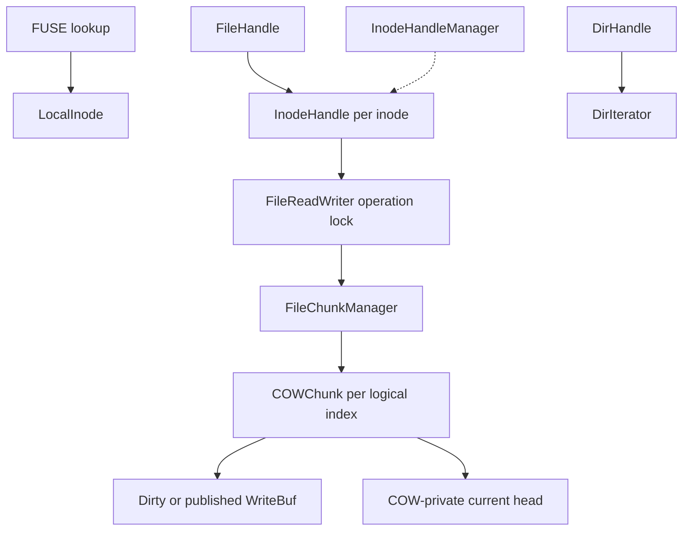

# Data structures and ownership

SwordFS separates **FileMetadata** (namespace and file reachability), private
**ChunkMetadata** (the selected mechanism's data version) and per-mount runtime
buffers. These are distinct authorities, not dual representations of one head.

## Authoritative records

| Structure | Content and owner |
| --- | --- |
| `SwordFsVolume` | Persisted volume configuration, selected mechanism, chunk size, data engine identity/location |
| Directory entry | FileMetadata name, child inode ID and type; multiple entries may refer to one file inode |
| `SwordFsInode` | FileMetadata inode attributes, EOF, link count, parent, symlink target and xattrs |
| `ChunkIndex` | Unsigned 64-bit logical coordinate from checked file offset and fixed chunk size |
| `ChunkMapping` | FileMetadata mapping from `ChunkIndex` to attached `ChunkID`; no common revision or size |
| `ChunkID` | Volume-scoped monotonic nonzero identity; never reused when detached |
| `COWChunkHead` | COW-private `{COWChunkRevision,size}` full-CAS value for one ChunkID |
| `COWChunkRevision` | Per-ChunkID immutable COW generation, with independent allocator |
| `ReclaimWork` | Optional opaque private cleanup handoff after FileMetadata removes an unlinked inode |
| `PendingDelete` | Best-effort opaque candidate for detached ChunkID or superseded private revision |

A directory entry does not duplicate the inode attributes. Hard links share
one inode and mapping. `nlink` is namespace authority independent of local
open descriptor references. A missing mapping inside EOF is a hole and reads
as zeroes. Both `ChunkIndex` and COW-private cleanup indices encode at full
64-bit width. Persistent records use the current beta layout only.

For COW, each immutable object's name is `COWObjectKey(ChunkID,revision)`.
Revisions are private to their ChunkID; the physical key never depends on the
inode number or logical index. Redis uses typed `chunk_refs:<ino>` entries
and separate COW-private head/revision keys. FileMetadata never persists
buffer state, COW size or private revision.

## Runtime ownership

One inode's handles share local dirty buffers through `FileReadWriter`.
Reads take the shared side of its fiber lock; write, flush and size mutation
serialize against each other. An unflushed buffer is not persistent shared
state. Weak runtime references can disappear after the final handle/lookup
release; this is not a cross-mount lease or coherent metadata cache.

`LocalInode` retains kernel-referenced cached identity until FORGET. A
NotFound from authoritative metadata may transition that retained local inode
to DETACHED (attributes show `nlink == 0`), without recreating durable data.

## Lifecycle boundaries

1. Writes change a local buffer; restart loses unflushed contents.
2. A flush uploads new immutable `(ChunkID,revision)` bytes and COW-private
   head state, then atomically attaches/finalizes the logical ChunkID and EOF
   with FileMetadata preconditions.
3. Rewrites CAS the COW-private head; successful newer revisions supersede
   earlier ones for all reads.
4. Last-link removal registers an orphan without deleting a live inode while
   an open descriptor can still need it.
5. `PrepareReclaim` freezes detached ChunkIDs as optional maintenance work and
   removes live inode/mapping authority under a Redis transaction.
6. GC verifies latest FileMetadata and COW head reachability before physical
   deletion. `CompleteReclaim` acknowledges only finished work.

See [publication](chunk-publication.md) and the [Redis schema](redis-metadata-schema.md).
