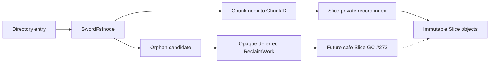
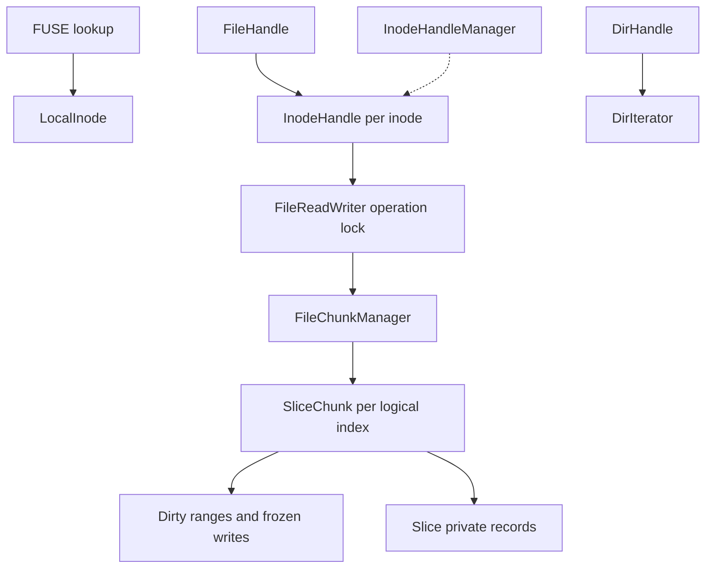

# Data structures and ownership

SwordFS separates **FileMetadata** (namespace, inode EOF and logical
reachability), typed **ChunkMetadata** (Slice's ordered immutable records)
and per-mount dirty buffers. They are distinct authorities.

## Authoritative records

| Structure | Content and owner |
| --- | --- |
| `SwordFsVolume` | Persisted mechanism (Slice=2), chunk size and backend configuration; retired COW=1 remains decodable but unmountable |
| Directory entry | Name, child inode ID and type; hard links share one inode |
| `SwordFsInode` | Inode attributes, EOF, link count, parent, symlink target and xattrs |
| `ChunkIndex` | Checked 64-bit logical chunk coordinate |
| `ChunkMapping` | FileMetadata mapping from ChunkIndex to attached ChunkID |
| `ChunkID` | Monotonic nonzero volume-scoped logical identity, never reused |
| `SliceID` | Monotonic nonzero volume-scoped immutable object identity |
| `SliceRecord` | Private logical position, SliceID, length and physical data offset, kept in publication order for each ChunkID |
| `ReclaimWork` | Opaque Slice maintenance handoff after a reclaim removes an unlinked inode |
| `PendingDelete` | Best-effort deferred cleanup identity; **not permission to physically delete** |

A missing mapping inside EOF is a sparse hole. FileMetadata never stores
Slice records, dirty buffers or physical object keys. Redis uses canonical
typed `chunk_refs:<ino>` entries, while Slice's private list lives under
`private_chunk_index:2:index:<chunk-id>`. Read publication order determines
which overlapping Slice record is authoritative.

## Runtime ownership

One inode's file handles share its local dirty view through `FileReadWriter`.
Reads take the shared side of its fiber lock, while writes, flush and size
mutations coordinate through the exclusive side. Unflushed bytes are visible
locally but are not durable. Weak runtime references expire after their last
user; they are not a distributed lease.

`LocalInode` retains kernel-referenced cached identity until FORGET. If
authoritative metadata reports NotFound, the retained local inode can become
DETACHED (`nlink == 0`) without reviving persistent records.

## Lifecycle boundaries

1. Writes enter the local dirty range view. Restart loses unflushed data.
2. A flush uploads immutable Slice objects, publishes private Slice records
   and conditionally attaches/finalizes FileMetadata mapping and EOF.
3. Later committed overlapping Slice records take precedence. Dirty overlays
   still reflect newer accepted local writes until safely published.
4. Last-link removal marks an orphan while open descriptors remain protected
   by the reclaim fence.
5. `PrepareReclaim` removes live inode/mapping authority and freezes detached
   ChunkIDs into an opaque maintenance envelope.
6. **No physical Slice GC currently runs**. Durable cleanup is deferred until
   #273 establishes authoritative private-index and remote-reader safety.

For current publication semantics see [architecture](architecture.md) and
[Redis metadata](redis-metadata-schema.md). The older
[COW publication design](chunk-publication.md) is historical only.
